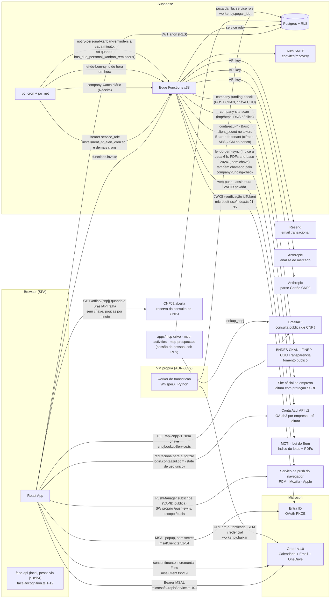

---
sources:
  - supabase/functions/**
  - supabase/config.toml
  - src/services/microsoftGraphService.ts
  - src/lib/analytics.ts
  - src/lib/session.ts
  - src/integrations/microsoft/msalClient.ts
  - src/integrations/microsoft/config.ts
  - src/lib/faceRecognition.ts
  - supabase/migrations/20260622130000_installment_nf_alert_cron.sql
  - supabase/migrations/20260717120000_time_tracking_reminders_cron.sql
  - supabase/migrations/20260622130000_installment_nf_alert_cron.sql
  - supabase/migrations/20260929120000_prospeccao_absorve_oportunidades.sql
  - src/services/cnpjLookupService.ts
  - supabase/functions/_shared/receita.ts
  - supabase/migrations/20261013130000_receita_preserva_regime.sql
  - supabase/functions/company-site-scan/index.ts
  - supabase/functions/company-funding-check/index.ts
  - supabase/functions/company-watch/index.ts
  - scripts/import-fomento.mjs
  - supabase/functions/lei-do-bem-sync/index.ts
  - supabase/functions/_shared/leiDoBem.ts
  - supabase/migrations/20261013120000_lei_do_bem_automatica.sql
  - supabase/migrations/20260831120000_realtime_publication_and_cron_via_vault.sql
  - apps/mcp-drive/src/index.ts
  - apps/mcp-activities/src/index.ts
  - apps/mcp-prospeccao/src/index.ts
  - supabase/functions/_shared/contaAzul.ts
  - supabase/functions/_shared/contaAzulConexao.ts
  - supabase/functions/_shared/cifra.ts
  - src/services/contaAzulService.ts
  - supabase/migrations/20261001120000_conta_azul_conexao.sql
  - supabase/migrations/20261001130000_conta_azul_sincronizacao.sql
  - supabase/functions/_shared/contaAzulSync.ts
  - supabase/functions/notify-personal-kanban-reminders/index.ts
  - supabase/migrations/20261021135000_meu_kanban_lembretes_e_configuracao.sql
  - public/push-sw.js
  - src/lib/webPush.ts
  - apps/transcription-worker/worker.py
  - supabase/functions/teams-transcripts-sync/index.ts
  - supabase/functions/teams-meeting-register/index.ts
---

# Mapa de Integrações

> Derivado do código em 2026-08-31; transcrição de reunião acrescentada em 2026-09-24 e ligada à tela em 2026-10-21; Conta Azul incluído em 2026-10-01.
> Quem chama quem, com que credencial.

## Visão geral

## Serviços externos

| Serviço | Consumidor | O quê | Credencial |
|---|---|---|---|
| BNDES (dados abertos) · FINEP · Portal da Transparência (CGU) | Edge Function `company-funding-check` e `scripts/import-fomento.mjs` | Fomento público por CNPJ: operações BNDES na hora, FINEP por importação semanal, contratos federais. Contrato: `.harness/integrations/fomento-publico.md` | BNDES e FINEP sem chave; CGU com secret `TRANSPARENCIA_API_KEY` (configurada em 13/10/2026) |
| MCTI · Lei do Bem (índice de lotes e PDFs do parecer técnico) | Edge Function `lei-do-bem-sync` (`_shared/leiDoBem.ts`), pelo cron `lei-do-bem-sync-hourly` e a cada "Atualizar" do fomento | Empresas analisadas por ano-base, do 2024 em diante: lê o índice no máximo a cada 6 h, carrega até 4 PDFs por chamada em `fomento_publico` e recalcula a Lei do Bem das empresas já consultadas. Anos anteriores: `scripts/import-fomento.mjs`. Contrato: `.harness/integrations/fomento-publico.md` | Nenhuma (página pública) |
| Conta Azul (API v2) | Edge Functions `conta-azul-connect`, `conta-azul-callback`, `conta-azul-disconnect` (`_shared/contaAzul.ts`) | Conexão por empresa (OAuth2 Authorization Code), empresa conectada, revogação. Escopo do Conta Azul é de administrador; o adaptador só lê. Contrato: `.harness/integrations/conta-azul.md`, ADR-0044 | `CONTA_AZUL_CLIENT_ID`/`_SECRET` do app do Pulse; token de cada empresa cifrado com `CONTA_AZUL_TOKEN_KEY` |
| Site oficial da empresa | Edge Function `company-site-scan` | Redes, WhatsApp, telefones, e-mails genéricos e pistas de sistema publicados pela empresa. Contrato: `.harness/integrations/site-da-empresa.md` | Nenhuma |
| BrasilAPI (CNPJ) | Browser (`src/services/cnpjLookupService.ts`) e `mcp-prospeccao` (`lookup_cnpj`) | Dados públicos da empresa pelo CNPJ para o cadastro da Prospecção: razão social, nome fantasia, CNAE, cidade. Só o CNPJ sai. Contrato: `.harness/integrations/brasilapi-cnpj.md` | Nenhuma (API pública) |
| CNPJá aberta (CNPJ, reserva) | Os mesmos consumidores da BrasilAPI, só quando ela falha (`cnpjLookupService.ts`, tradução em `_shared/receita.ts`) | O mesmo cadastro, sem regime tributário; a RPC da Receita mantém o regime gravado. Contrato: `.harness/integrations/brasilapi-cnpj.md` (seção Reserva) | Nenhuma (API pública, poucas consultas por minuto) |
| Microsoft Entra ID | Browser (`msalClient.ts:54`) | Login OAuth Auth Code + PKCE | client_id público, sem secret (`config.ts:1-16`) |
| Google Identity (**planejado**, ADR-0029 / PUL-225) | Browser (Google Identity Services) → Edge Function `google-sso` | Login social: ID token OpenID Connect com escopos mínimos `openid email profile`. A função valida JWKS do Google, `iss`, `aud`, `exp` e `email_verified`, casa o e-mail com funcionário ativo (o tenant vem dele) e emite magiclink pela Admin API. Nada do Drive | `VITE_GOOGLE_CLIENT_ID` (público) no front; `GOOGLE_CLIENT_ID` como secret da função; sem client secret (só ID token) |
| Microsoft Graph v1.0 | Browser (`microsoftGraphService.ts:43`) | Calendário (`/me/calendarView`, `/me/events`) e Email (`/me/mailFolders/inbox/messages`, `/me/messages/{id}` com `internetMessageId` — `:902`); escopos `Calendars.ReadWrite`, `Mail.Read` (`:51`). Gravação automática da reunião do Teams (`/me/onlineMeetings`, `PATCH recordAutomatically`) com `OnlineMeetings.ReadWrite` pedido só no uso (`ONLINE_MEETING_SCOPES`, ADR-0039). Desde 21/10/2026 a aba E-mails está no menu de todos, e o e-mail aberto pode ser salvo no projeto como cópia em `project_emails` (ADR-0047) | Bearer MSAL, renovado silent; backend nunca vê o token |
| Microsoft Graph — OneDrive | Browser (`microsoftGraphService.ts:979-1260`) | Seletor de pasta raiz do projeto: `/me/drive/root`, `/drives/{id}/items/{id}/children`, `/me/drive/sharedWithMe` e `/shares/u!{b64}/driveItem`; upload (`uploadDriveFile`, `:1207`, devolve o item criado) e `ensureDriveFolder` (`:1239`), usados também para copiar anexos de e-mail salvo no projeto para `E-mails/<data> <assunto>` (ADR-0047). Escopo `Files.ReadWrite.All` **em conjunto separado** (`FILES_SCOPES`, `:979`) | Bearer MSAL adquirido por consentimento incremental (`msalClient.ts:219`), só ao abrir o seletor |
| Resend | `send-invite-email/index.ts:135`, `send-candidate-hired-email/index.ts:126`, `notify-personal-kanban-reminders` | Email transacional (ver divergência 2); lembrete do Meu Kanban para quem não desligou o e-mail | `RESEND_API_KEY` |
| Serviço de push do navegador (Web Push) | `notify-personal-kanban-reminders` (envio), `src/lib/webPush.ts` (inscrição) | Lembrete do Meu Kanban com o Pulse fechado. Inscrição por funcionário e navegador em `push_subscriptions`; 404/410 apaga a inscrição. ADR-0050 | `VAPID_PUBLIC_KEY`, `VAPID_PRIVATE_KEY`, `VAPID_SUBJECT` (Edge); `VITE_VAPID_PUBLIC_KEY` (front) |
| Anthropic | `market-analysis-start/index.ts:317` (Opus 4), `market-analysis-refine/index.ts:37` (Sonnet 4) | Relatórios de análise de mercado | `ANTHROPIC_API_KEY` |
| Anthropic (Opus 5) | `parse-cnpj-card/index.ts:70-89` | Extração de Cartão CNPJ (PDF em base64 via bloco `document`), com schema Zod em `output_config` — o modelo é obrigado ao formato, sem pós-processamento de markdown; usado por `ClientForm` e `SupplierFormDialog` | `ANTHROPIC_API_KEY` |
| Amplitude, modo **vitrine** | Browser, `src/lib/analytics.ts` → `startVisitorAnalytics` em `src/main.tsx`, só sem sessão guardada (`src/lib/session.ts`) | Instância `vitrine`: `identityStorage: 'none'` (sem cookie), `trackingOptions.ipAddress: false`, sem replay; autocapture só de páginas vistas e atribuição (referrer/UTM). Mede a vitrine e o cadastro; referrers de IA (chatgpt.com, perplexity.ai, gemini.google.com) medem GEO (PUL-239, ADR-0030) | chave pública de browser no código |
| Amplitude, modo **produto** (autocapture + session replay 100%) | `startProductAnalytics`, chamado por `AuthContext.applyEmployeeResult` **só com funcionário ativo**; cala a vitrine e herda seu device id; `setOptOut(true)` no `signOut` | Gravação de sessão e eventos nomeados da área logada (`AlocacaoPage`/`EmployeeAllocationPanel`). Nunca roda antes do login | idem |
| Reconhecimento facial | `src/lib/faceRecognition.ts:1-12` | **100% local no browser** (`@vladmandic/face-api`), threshold 0.6; só os pesos vêm da CDN jsDelivr | — |
| Microsoft Graph — transcrição do Teams (ADR-0052) | Edge Function `teams-transcripts-sync` (cron de 10 em 10 min) | `getAllTranscripts` por organizador e o `/content` em WebVTT de cada transcrição de reunião vinculada ao projeto. Contrato: `.harness/integrations/teams-transcricao.md` | App próprio "Pulse — Transcrições", client credentials: `MICROSOFT_TRANSCRIPTS_CLIENT_ID`/`_SECRET`, permissão de aplicação `OnlineMeetingTranscript.Read.All` limitada por application access policy do Teams |
| Worker de transcrição (VM própria, ADR-0039, plano B) | `apps/transcription-worker/worker.py` | Puxa job pendente de `meeting_transcriptions`, baixa a gravação do OneDrive pela URL pré-autenticada e devolve o texto. **Não expõe porta** (só conexão de saída) e **não recebe credencial do Graph** | `SUPABASE_SERVICE_ROLE_KEY` na VM; `HF_TOKEN` para a separação de vozes (pyannote) |
| SMTP do Supabase Auth | `create-employee-user`, `resend-employee-invite`, `request-first-access`, `register-tenant` | Convites, recovery links e confirmação de e-mail do autocadastro (`resend` tipo `signup`, redireciona para `/boas-vindas`) | interno Supabase |

## Edge Functions por grupo

**SSO** — `microsoft-sso`: valida idToken via JWKS + `tid` e emite magiclink
`tokenHash` (`index.ts:91-111, 152-161`). `verify_jwt=false`
(`config.toml:5-7`). Ver ADR-0016 e sequência no `overview.md`.
`google-sso` (**planejada**, ADR-0029 / PUL-225): mesmo desenho, com JWKS do Google, `iss`
`accounts.google.com`, `aud` igual ao client id e `email_verified`; sem `tid`, o tenant vem do
funcionário. O que for comum às duas funções sai para `_shared/` quando a segunda nascer.

**RH / convites** — `create-employee-user` (convite via `inviteUserByEmail`,
valida JWT manualmente — `index.ts:108, 263-267`), `resend-employee-invite`
(exige admin — `index.ts:91`), `request-first-access` (público),
`register-tenant` (autocadastro público, PUL-227: corpo validado com zod, honeypot
`website`, limite por IP e por e-mail em `signup_attempts`, usuário nasce não confirmado e a
confirmação sai pelo SMTP do Auth via `auth.resend` tipo `signup`; rollback de tenant,
usuário e funcionário em falha), `recalculate-employee-costs`, `send-candidate-hired-email`,
`send-invite-email`.

**Ponto / facial** — `record-time-punch` (recebe `face_match_status` calculado
**no cliente** — `index.ts:330-349`), `enroll-face-profile` (descriptor de 128
floats), `delete-face-profile`, `submit-time-adjustment`,
`decide-time-adjustment`, `register-absence-period`.

**Notificações in-app** (gravam em `notifications`, sem serviço externo):

| Função | Agendamento (pg_cron → pg_net) |
|---|---|
| `notify-time-tracking-reminders` | `0 9 * * *` — `20260717120000_*.sql:21-34` |
| `notify-installment-alerts` | `0 8 * * *` — `20260622130000_*.sql:22-35` |
| `notify-personal-kanban-reminders` | `* * * * *`, com a chamada condicionada a `has_due_personal_kanban_reminders()` — `20261021135000_*.sql`. Além do Inbox, manda e-mail (Resend) e push (VAPID). Reserva com `claim_due_personal_kanban_reminders` (SKIP LOCKED): no máximo uma entrega, janela de 6 h (ADR-0050) |
| `notify-timesheet-reminder`, `notify-timesheet-pending`, `timesheet-alert-managers`, `timesheet-reminder-employees` | **sem cron no repo e sem chamador** (ver divergência 3) |

Crons só-SQL (sem edge function): ativação de versões de employee `0 3 * * *`
(`20260721150000_*.sql:85-88`); recálculo trimestral de ticket médio
(`20260806130000_*.sql:193-197`, `20260806140000_*.sql:194-198`); arquivamento do Feito do
Meu Kanban `30 6 * * *` (`archive_done_personal_kanban_cards()`, `20261021135000_*.sql`).

**Integração Conta Azul** (ADR-0044) — `conta-azul-connect` grava `state` de uso único e
devolve a URL de autorização; `conta-azul-callback` consome o `state`, troca o código, lê a
empresa conectada e guarda o token cifrado; `conta-azul-disconnect` revoga no Conta Azul e
apaga a conexão. As três validam a sessão dentro (`verify_jwt=false`), exigem
`integracoes:gerir` e escrevem com service role, porque token e state não têm policy. A
renovação passa pela trava `conta_azul_claim_refresh`: o refresh token rotaciona.
`conta-azul-sync` (parte 2) mantém o espelho de parcelas e centros de custo: cron a cada 15 min
(Bearer service role) ou "Sincronizar agora" (sessão + `integracoes:gerir`), em segundo plano
via `EdgeRuntime.waitUntil`, com trava `conta_azul_claim_sync`.
Função chamada pelo cron reconhece o cron por `_shared/chamadaDeServico.ts`
(`public.caller_is_service_role()`): a chave do Vault (JWT legado) e a `SUPABASE_SERVICE_ROLE_KEY`
do ambiente têm formatos diferentes, e comparar as strings deixou `company-watch` e
`conta-azul-sync` respondendo 401 a todo cron até 01/10/2026.

**Análise de mercado** — `market-analysis-start` / `-refine` / `-status`
(jobs em `market_analysis_jobs`).

**Transcrição de reunião** — `transcription-enqueue`: enfileira a transcrição de uma
gravação do OneDrive (ADR-0039). O insert em `meeting_transcriptions` vai com o **token da
pessoa** (userClient, sem devolver a linha), então quem autoriza é a policy
(`can_request_meeting_transcription`), não a função; o service role entra só para gravar a
URL pré-autenticada em `meeting_transcription_sources`, tabela sem policy nem GRANT para o
cliente, e para desfazer a linha se esse insert falhar. Gravação já enviada que está em
`falhou` volta para a fila pela mesma função, depois de conferir a mesma regra com o
usuário do token. A URL passa por allowlist de host (`HOSTS_PERMITIDOS`): sem ela, um corpo
escolhido pelo cliente faria a VM baixar qualquer endereço — SSRF com a nossa rede do outro
lado. Ela nunca é registrada em log nem devolvida ao cliente. O aviso de pronta ou não
concluída vai para `notifications` pelo trigger `meeting_transcriptions_notify_finished`.

**Transcrição do Teams** (ADR-0052) — `teams-meeting-register` vincula reunião do Teams ao projeto: valida o
id token do Entra como o `microsoft-sso`, exige e-mail do token igual ao do funcionário logado e
`can_request_meeting_transcription`, e grava o `oid` como organizador em `project_online_meetings` (só a
service role escreve ali), com o horário da reunião que a Agenda conhece (`starts_at`/`ends_at`/`is_series`, para a
aba mostrar se ela aconteceu e se a transcrição veio). `teams-transcripts-sync` (cron de 10 em 10 min com a chave de serviço, ou o botão "Buscar transcrições agora" com a
sessão de quem pode pedir transcrição no projeto, restrito a ele) traz a
transcrição pronta do Teams das reuniões vinculadas, com a credencial do app próprio; o token do app só vai
para URL de `graph.microsoft.com`. Sem os secrets do app, responde `nao_configurado` e não faz nada.

**Seed** — `seed-admin` (protegido por `SEED_SECRET_TOKEN` — `index.ts:17`),
`seed-demo-tenant` (ver ponto de atenção 1).

**MCP** — três servidores MCP de saída, todos operando **sob a RLS**: entram com as
credenciais da própria pessoa usando a chave publicável, então enxergam só o que ela
enxerga. `apps/mcp-drive` (arquivos, leitura de projeto e horas), `apps/mcp-activities`
(kanban de atividades) e `apps/mcp-prospeccao` (o comercial, desde 23/09/2026), cada
um com sessão em arquivo próprio sob `~/.og-pulse/`, 0600 — o supabase-js rotaciona o
refresh token, e um arquivo compartilhado faria os processos se derrubarem.

`mcp-prospeccao` não duplica regra: a cadência é do trigger no banco, descartar/reabrir
vêm de `src/lib/prospecting/transitions.ts` (o mesmo módulo da tela) e rótulos/métricas
são importados de `src/` pelo alias `@/`, resolvido pelo esbuild. A situação "Abordar /
Não abordar" da empresa vem de `src/lib/prospecting/companyStatus.ts` (a mesma regra da
tela Empresas), e tarefa herda tenant e responsável do contato pelo trigger
`prospect_tasks_inherit_parent`. A única regra própria do MCP é a de duplicidade no
cadastro conversacional (`apps/mcp-prospeccao/src/duplicidade.ts`: cliente já ligado →
CNPJ → LinkedIn → nome sem contradição), que só lê e escolhe a empresa — o banco segue recusando CNPJ e
LinkedIn repetidos.

Desde 28/09/2026 a Prospecção é o quadro comercial de ponta a ponta e o contato termina
nela mesma, em Ganho ou Perda — a conversão em Oportunidade saiu. Em 29/09/2026 as
ferramentas de Oportunidade (`list_opportunities`, `create_opportunity`,
`update_opportunity`, `move_opportunity_stage`) saíram do `mcp-drive` (versão 2.0.0), e o
MCP deixou de escrever em `leads`: `mcp-prospeccao` (1.1.0) é o único servidor comercial, e
as `instructions` dele dizem isso ao cliente. Na 1.2.0 (29/09/2026, ADR-0040) o contato
ganha valor estimado e observações (o concorrente veio junto e saiu em 30/09/2026,
migration `20260930120000`); `search_clients` liga a empresa a um
cliente da carteira (`client_id`, checado no tenant — a FK não olha tenant), `lookup_cnpj`
consulta a BrasilAPI pelo mesmo `cnpjLookupService.ts` da tela, e `get_contact` mostra o
orçamento e o projeto vinculados (`budgets/projects.prospect_id`), só leitura. Ganho e data de etapa usam as mesmas RPCs da
tela, `mark_prospect_won` e `set_prospect_stage` (`SECURITY INVOKER`); as regras de desfecho
são do trigger `prospects_outcome_rules`. `get_prospecting_metrics` monta o texto com
`src/lib/prospecting/periodMetrics.ts` e `metricsReadings.ts`, o mesmo cálculo da aba
Métricas.

`mcp-activities` usava `SUPABASE_SERVICE_KEY` até 02/09, o que bypassava a RLS e com
ela o `tenant_id`. Regra que fica: **MCP nunca usa service_role.** A RLS é a barreira
do produto, e um LLM no volante é exatamente o consumidor que não deve contorná-la —
capacidade nenhuma (ADR-0027) alcança quem não passa pela policy. Corolário: `tenant_id`
e autoria não são parâmetros de tool; derivam da sessão.

## Variáveis de ambiente

Não existe `.env.example` (vale criar). Frontend: `VITE_SUPABASE_PROJECT_ID`,
`VITE_SUPABASE_URL`, `VITE_SUPABASE_PUBLISHABLE_KEY`,
`VITE_MICROSOFT_CLIENT_ID`, `VITE_MICROSOFT_TENANT_ID` — os dois últimos com
fallback hardcoded (`src/integrations/microsoft/config.ts:19-25`).

Edge Functions: `SUPABASE_URL`, `SUPABASE_ANON_KEY`,
`SUPABASE_SERVICE_ROLE_KEY`, `MICROSOFT_CLIENT_ID`, `MICROSOFT_TENANT_ID`,
`ANTHROPIC_API_KEY`, `RESEND_API_KEY`, `RESEND_FROM_EMAIL`,
`SEED_*`, `CONTA_AZUL_CLIENT_ID`, `CONTA_AZUL_CLIENT_SECRET`, `CONTA_AZUL_REDIRECT_URI`,
`CONTA_AZUL_TOKEN_KEY`. A `LOVABLE_API_KEY` deixou de existir com a migração para Supabase
próprio — nenhuma function depende mais do gateway do Lovable.
pg_cron lê os segredos do Vault via `public.cron_secret()`
(`20260831120000_realtime_publication_and_cron_via_vault.sql`); o desenho
anterior usava os settings `app.supabase_url` e `app.service_role_key`, que
nunca foram aplicados e deixaram os três jobs falhando desde 22/06.

## Pontos de atenção (código, preexistentes — candidatos a TD/correção)

1. **`seed-demo-tenant` é endpoint aberto**: `verify_jwt=false`
   (`config.toml:43`), sem verificação de token/header no código, e com
   credenciais demo hardcoded (`index.ts:21-25`).
2. **`recalculate-employee-costs`** tem `verify_jwt=false` sem checagem de chamador no
   corpo. `register-tenant` é público **de propósito** (autocadastro, PUL-227) e desde 09/09
   valida o corpo com zod, tem honeypot e limite por IP/e-mail; falta captcha (Turnstile,
   pendente de chaves) e a constraint única de CNPJ no banco (a função já recusa repetido).
3. **`market-analysis-start` confia em `userId`/`tenantId` do body** sem
   validar sessão (`index.ts:274-282`) — quebra o modelo de autorização por
   recurso.
4. **Verificação facial é client-side**: `record-time-punch` aceita
   `face_match_status`/`score` calculados no navegador (`index.ts:330-349`) —
   o servidor não re-verifica.
5. **`FILES_SCOPES` não pode ser fundido em `GRAPH_SCOPES`**
   (`microsoftGraphService.ts:962` vs `:47`). `GRAPH_SCOPES` é usado em toda
   aquisição de token, inclusive as silenciosas de agenda; somar o escopo de
   arquivos ali faria agenda e e-mail exigirem o consentimento de admin de
   `Files.ReadWrite.All` e quebrarem num tenant sem ele. Ver
   `.harness/integrations/onedrive.md`.

## Divergências código × doc

1. **Nomenclatura**: resolvida em 29/09/2026 — a função e o cron `notify-lead-follow-ups`
   saíram junto com a tabela `leads` (Prospecção absorveu Oportunidades, migração
   20260929120000).
2. **Resend meio-desligado**: `resend-employee-invite` e
   `request-first-access` declaram "não usa mais Resend" (`index.ts:7` de
   cada), mas `send-invite-email` (sem nenhum chamador no repo — provável
   legada) e `send-candidate-hired-email` ainda dependem dele.
3. **4 funções de lembrete de timesheet órfãs** (sem cron no repo e sem
   chamador): ou o agendamento vive só no painel do Supabase (documentar), ou
   são código morto.
