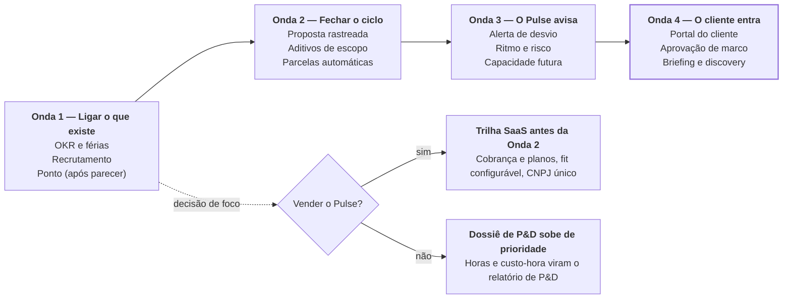

# Roadmap do Pulse — sistema operacional da Origami

> Documento de **planejamento** (não é doc código-derivada; sem `sources:`/drift-check).
> Gerado em 2026-10-21 por Italo Castro. Versão viva, com comentários e a coluna Decisão
> editável: [Claude Docs](https://claude.ai/artifact/8c8Z1f4STiVjhZNF2DgERj).
> Complementa o [roadmap.md](roadmap.md) por tema (ondas de valor ancoradas nos OKRs do PUL).

## Resumo

O Pulse já leva uma oportunidade até a margem do projeto e a conciliação com o Conta Azul. Para virar o sistema operacional da Origami e o nosso diferencial, faltam três coisas. O cliente precisa enxergar o trabalho, o sistema precisa avisar antes do problema e o que já foi construído precisa estar no menu. O roadmap resolve isso em quatro ondas e traz do projete.app o que ele tem de melhor no relacionamento com o cliente.

As ondas se leem da esquerda para a direita; embaixo, os dois caminhos que a decisão de foco abre. A Onda 4 é o diferencial de mercado.

**Decisão em aberto:** o foco dos próximos meses é a operação da Origami ou vender o Pulse para outras empresas? Com foco na Origami, a ordem das ondas vale e o dossiê de P&D sobe de prioridade. Com foco em vender, a Trilha SaaS entra antes da Onda 2.

## Onde o Pulse está hoje

O caminho do dinheiro está completo: oportunidade → orçamento → projeto → alocação → hora lançada → custo-hora → margem → conciliação com o Conta Azul. O que falta está fora desse caminho.

O que já nos diferencia, e nenhum PSA de mercado tem junto:

- Prospecção com dados da Receita, rede de sócios, faturamento estimado, selo Indústria pelo CNAE e sinal de Lei do Bem.
- Fomento público consultado na hora (BNDES, FINEP, Lei do Bem, Portal da Transparência).
- Custo cheio da hora com encargos, INSS progressivo e configuração com vigência.
- Alocação no padrão GPO, pro rata por dias úteis.
- Três servidores MCP locais: dá para conversar com a empresa pelo Claude.

As três lacunas:

| Lacuna | Evidência | Onda que resolve |
| --- | --- | --- |
| O cliente não vê nada | Não existe portal, proposta online nem aprovação de entregável; tudo é interno | Onda 2 e Onda 4 |
| O sistema não avisa | O alerta de desvio de orçamento, momento de valor do roadmap (T2), não existe; há só um realce visual na aba Despesas | Onda 3 |
| Módulos prontos estão escondidos | Estratégia, Férias, Recrutamento, Fornecedores e Benefícios fora do menu; Ponto, Agenda e E-mail só rodando local | Onda 1 |

## Onda 1 — ligar o que já existe

Metade do sistema operacional já está construída e fora do menu; esta é a onda de menor custo. O corte de menus do MVP, em 06/07/2026, escondeu módulos que funcionam. Cada linha pede uma decisão do time (Ligar agora, Depois ou Descartar).

| Módulo | Situação hoje | O que falta para ligar | Decisão |
| --- | --- | --- | --- |
| Estratégia (OKR, check-ins, iniciativas) | Pronto, fora do menu desde 06/07 | Revisar a jornada e voltar ao menu de Admin e Gerente | |
| Férias (gestão e Minhas Férias) | Pronto, nenhum link aponta para ele | Item de menu para RH e colaborador; aprovação por todos os gerentes já existe (ADR-0003) | |
| Benefícios e Ferramentas | Abre só pela ficha do funcionário | Item de menu no RH | |
| Fornecedores | Fora do menu desde 06/07 | Volta junto com despesas e orçamentos | |
| Recrutamento (vagas, candidatos, Trabalhe conosco) | Pronto, fora do menu | Liberar o RH nas próprias rotas (divergência D5 da matriz) | |
| Ponto eletrônico | Só aparece rodando local | Parecer jurídico sobre biometria (ADR-0009, LGPD) | |
| Agenda e E-mail (Microsoft Graph) | Só aparece rodando local | Decidir se é produto ou prova de conceito | |
| Caixa de Entrada e Meu Kanban | No ar, sem item de menu | Item de menu; card de projeto editável no kanban | |

Antes de construir análises novas, vale olhar os componentes prontos que nenhuma tela usa: `ProjectHealthTable`, `EmployeeUtilizationTable`, `NpsPortfolioSection` e `DetractorAlertTable`. O NPS de stakeholders, por exemplo, não aparece em lugar nenhum.

## Onda 2 — fechar o ciclo do comercial ao financeiro

A Onda 2 leva o orçamento até o cliente e traz a mudança de escopo de volta para o financeiro. As duas peças já funcionam no projete.app. Mudança de escopo não cobrada é onde consultoria e software sob medida mais perdem margem.

**Proposta online rastreada**

- O cliente recebe um link que mostra só a versão vigente do orçamento.
- O link registra visualização, download, aceite, pedido de ajuste e dúvida.
- O aceite gera um PDF e avisa o responsável pela oportunidade.
- Os marcos de pagamento da proposta viram as parcelas do projeto no fechamento.
- No Pulse, o orçamento já tem versões, margem e aprovação por margem mínima; falta o lado do cliente.

**Aditivos de escopo** (jornada J18 do GP, que ainda não existe)

- Aditivo numerado por projeto, com escopo, valor, prazo e a proposta de origem.
- Uma oportunidade pode virar aditivo de um projeto em andamento, em vez de projeto novo.
- O aditivo aprovado gera as parcelas novas e entra no planejado × realizado do projeto.

O ciclo completo fica assim:

1. A oportunidade gera o orçamento.
2. O orçamento vira proposta enviada por link.
3. O aceite cria o projeto e as parcelas.
4. A mudança de escopo vira aditivo, com proposta própria.
5. O aditivo aprovado gera novas parcelas, conciliadas no Conta Azul.

## Onda 3 — o Pulse começa a avisar

O roadmap atual (tema T2) já diz que o momento de valor do Pulse é o alerta de desvio, e ele ainda não existe. A Onda 3 constrói esse alerta e traz do projete.app a leitura de ritmo, risco e capacidade. Tudo se apoia em dados que o Pulse já tem: horas planejadas × lançadas, alocação GPO, feriados e custo-hora.

| Funcionalidade | Regra (como no projete.app) | Quem recebe |
| --- | --- | --- |
| Alerta proativo de desvio | Avisa quando as horas lançadas se aproximam das previstas antes do marco; hoje só existe o realce visual na aba Despesas | GP do projeto, na Caixa de Entrada |
| Previsão pelo histórico | Projeto sem previsão de horas usa a mediana dos projetos encerrados do mesmo tipo | GP, ao montar o planejamento |
| Ritmo | Quanto do escopo foi feito dividido pela fração das horas já gastas, com projeção de término | GP e Admin |
| Projeto em risco | Junta horas estouradas, atraso no marco e projeto parado (no projete, 14 dias sem movimento) | Admin, no Dashboard Executivo |
| Capacidade futura | Ocupação mensal = demanda ÷ capacidade (jornada × dias úteis − feriados), com aviso acima de 100% | Quem aloca a equipe |

Os limites (quanto antes avisar, quantos dias contam como parado) precisam ser definidos para a realidade da Origami; os do projete são ponto de partida.

## Onda 4 — o cliente entra no Pulse

Esta é a onda que vira diferencial de mercado: o cliente da indústria acompanha o projeto sem pedir relatório de status. Para quem vende software sob medida e consultoria, isso pesa na venda. As duas peças vêm do projete.app.

**Portal do cliente por link**

- Topo com a etapa atual ("Etapa 3 de 6") e o que está "Aguardando você".
- Aprovação de marco ou entregável: o GP escolhe quais marcos pedem aceite, e o marco concluído vira pendência com botão Aprovar e e-mail.
- Arquivos do OneDrive escolhidos para o cliente, por arquivo ou pasta.
- Formulários e orientações do projeto.
- Resumo em PDF e aviso por e-mail.
- Quem entra são os stakeholders, que já pertencem ao cliente (ADR-0037). O portal também é o lugar natural para coletar o NPS de stakeholders, que hoje não tem tela.

**Briefing e discovery por formulário**

- Modelos de formulário por tipo de serviço, respondidos por link ou pelo portal.
- A IA preenche o formulário a partir de um documento que o cliente mandou (o Pulse já usa o Claude para ler o Cartão CNPJ).
- Primeiro uso: o levantamento dos sistemas que o cliente já usa (ERP, MES, planilhas, legados), base da frente de integração.
- Segundo uso: o diagnóstico de elegibilidade a fomento, que alimenta a frente de financiamento de inovação.

## Aposta exclusiva — dossiê de P&D

O Pulse pode gerar o dossiê de gastos de P&D para Lei do Bem e FINEP a partir do que a equipe já lança. Nenhum concorrente une operação e fomento assim. O recurso liga duas frentes da Origami, software sob medida e financiamento de inovação.

O que já existe e sustenta a ideia:

- Horas por projeto e por pessoa, com aprovação.
- Custo cheio da hora (encargos, INSS, benefícios) com vigência, sem reescrever o passado (ADR-0036).
- Centro de custo como âncora de custo e receita (ADR-0031).
- Sinal de Lei do Bem e histórico de fomento na prospecção.

O que seria construído:

- Marcar projeto ou atividade como P&D, com a linha de pesquisa.
- Relatório por período: pessoas, horas, custo e evidências (arquivos e atividades do projeto).
- Exportação no formato que o formulário do MCTI (FORMP&D) e a prestação de contas da FINEP pedem.

**Hipótese a validar** com quem cuida de fomento antes de qualquer história: quais campos cada relatório exige, e se as horas da Origami em projeto de cliente contam como gasto de P&D do cliente.

## Trilha SaaS — se o foco for vender o Pulse

O Pulse já tem a vitrine de um SaaS, mas ainda não tem como cobrar. Existem autocadastro, teste de 14 dias, painel de uso entre empresas e site com 18 páginas por segmento. As metas do roadmap são 30 a 40 clientes pagantes (O2) e 80 a 100 clientes com ARR de R$ 1,2 milhão (O3). Se o foco for vender, estes itens entram antes da Onda 2.

| Item | Situação hoje | Referência no projete.app |
| --- | --- | --- |
| Cobrança e planos | `tenants.plan` só tem `trial` ou `active`; reativação é um comando SQL manual | 4 planos, cobrança recorrente pelo Stripe, Pix com baixa manual |
| Recursos por plano | Não existe limite por plano | `src/lib/planos-recursos.ts` |
| Nota de fit configurável por empresa | Frentes e pesos fixos nas da Origami (`src/lib/prospecting/fit.ts`) | — |
| Autocadastro seguro | Faltam captcha e CNPJ único (PUL-227) | — |
| Login com Google | ADR-0029 proposto, não implementado | — |
| Base interna limpa | Dois tenants "Origami Lab" em produção (TD-0027) | — |
| Novidades e sugestões com voto | Não existe | Página `/novidades`, sugestões com triagem e resposta |

A disposição a pagar levantada no material do hackathon vai de R$ 900 a R$ 9.000 por mês (`.hackaton/sobre-pulse.md`); vale confirmar com os clientes em teste antes de fixar os planos.

## O que não trazer do projete.app

O projete.app foi feito para escritórios de arquitetura; boa parte dele não serve à Origami ou duplica o que o Pulse já decidiu.

| Item | Por que não |
| --- | --- |
| Financeiro completo (contas a pagar e receber, DRE, OFX, notas da SEFAZ) | Duplica o Conta Azul, que o Pulse usa como fonte (ADR-0044) |
| Plugins de CAD e BIM, Projete Connect | Nicho de arquitetura; a ideia de capturar horas pela ferramenta de trabalho entra em Mais ideias |
| Diário de obra, orçamentos de obra, CUB e SINAPI | Nicho de construção |
| Escritório em 3D como home | Bonito para vitrine, pouco valor na operação |
| Agentes de IA do admin (SDR, closer, CS) | Esboço que depende de um serviço fora do repositório |

**Como reaproveitar código:** o projete.app é Next.js com Prisma e autorização no código da aplicação, sem RLS. Componentes React e regras puras de `src/lib/` (que têm testes) dão para trazer quase direto. Acesso a dados e autorização precisam ser reescritos no Pulse com RLS e capacidade.

## Cuidados e decisões que pedem ADR

Portal, proposta e briefing por link são a primeira superfície pública do Pulse com dado de projeto; essa decisão vem antes de qualquer tela.

| Tema | O que precisa ser decidido | Onde |
| --- | --- | --- |
| Links públicos (portal, proposta, briefing) | O que o cliente vê, nunca custo, margem ou horas por pessoa; expiração e revogação do link; isolamento por empresa | ADR novo, antes da Onda 2 |
| Aditivos de escopo | Como o aditivo altera valor, parcelas e planejado do projeto sem reescrever o passado | ADR novo, junto com a J18 |
| Capacidade por funcionalidade | Toda tela nova nasce com a capacidade, a linha na matriz e a política de RLS equivalente | ADR-0027, regra já vigente |
| IA que altera dados | Padrão de prévia e aprovação humana antes de gravar, como no projete.app | ADR novo, quando a IA escrever |
| Biometria no ponto | Parecer jurídico antes de ir a produção | ADR-0009, pendente |
| MCP remoto com OAuth | Pausado em 10/09; se retomar, o servidor OAuth 2.1 do projete.app é a referência | Decisão do Italo |

Na interface, portal e proposta seguem o design system oficial e a nomenclatura Oportunidade e Pipeline, nunca os termos do projete.app.

## Mais ideias para melhorar o sistema

Além das ondas, estas ideias aproveitam peças que o Pulse já tem. Eu começaria por três: o Pulse da semana, o timesheet que se preenche sozinho e a sustentação com banco de horas. As duas primeiras custam pouco e mudam o uso diário. A terceira abre receita recorrente com o software que a Origami já entrega.

| Tema | Ideia | O que resolve | Apoia-se em |
| --- | --- | --- | --- |
| Operação | Pulse da semana | Resumo automático para sócios e GPs: receita, margem, projetos em risco, horas não lançadas, oportunidades paradas | Dashboard Executivo, Análises, rotinas agendadas |
| Operação | Fechamento do mês guiado | Mostra o que impede fechar o mês: horas sem lançar ou aprovar, nota não emitida, recebimento não conciliado | Horas não lançadas, conciliação, alerta de NF |
| Operação | Orçamento que aprende | Sugere horas por papel a partir de projetos parecidos e mostra orçado × realizado no encerramento | Horas por projeto, catálogo de serviços, versões do orçamento |
| Operação | Previsão de receita e caixa | Parcelas futuras, oportunidades ponderadas pela chance e aditivos, de 3 a 6 meses à frente | Parcelas do projeto, Métricas comerciais, Conta Azul |
| Operação | Sustentação com banco de horas | Contratos recorrentes de suporte do software entregue: chamados, SLA e horas consumidas visíveis ao cliente | Timesheet, centro de custo, portal (Onda 4) |
| Pessoas | Timesheet que se preenche sozinho | Sugere lançamentos a partir da agenda, dos ritos do projeto e dos cards movidos; a pessoa só confirma | Microsoft Graph, ritos ligados ao calendário (ADR-0011), kanban de atividades |
| Pessoas | Mapa de competências | A alocação sugere quem tem a habilidade e está livre | Alocação GPO, ficha do funcionário |
| Pessoas | Jornada do funcionário completa | Holerites e documentos (J9), meu perfil (J10), férias no menu | Folha e Férias prontas |
| Comercial | Radar de editais | Cruza editais abertos (FINEP, BNDES, FAPs) com as empresas da carteira e avisa quem se encaixa | Fomento público, prospecção, nota de fit |
| Comercial | IA por cima da nota de fit | Resumo da empresa e sugestão de abordagem usando os mesmos sinais, como prevê o ADR-0042 | Sinais da prospecção, Claude já usado no Cartão CNPJ |
| Comercial | Contato do site vira oportunidade | O formulário do site da Origami cria a oportunidade já com a origem | Prospecção, analytics da vitrine |
| Comercial | Biblioteca de cases | Todo projeto encerrado vira um case (problema, solução, sistemas integrados, resultado) para usar em propostas | Projetos, arquivos no OneDrive, Knowledge Platform no papel |
| Plataforma | Aprovações no Teams | Aprovar timesheet, férias, ajuste de ponto e margem baixa sem abrir o Pulse | Microsoft SSO, Caixa de Entrada |
| Plataforma | Ata de reunião vira tarefa | A transcrição gera atividades no projeto e registro na oportunidade | Kanban de atividades, histórico da oportunidade, MCP |
| Plataforma | Progresso vindo do Jira ou DevOps | As sprints do projeto entram no Pulse sem lançar duas vezes | Kanban com sprints e releases |
| Plataforma | Assistente dentro do app | Perguntas em português sobre a operação, sem precisar instalar o MCP | Tema T7 do roadmap, ferramentas MCP existentes |

## Próximos passos

A primeira decisão é a de foco; ela define a ordem de tudo o que vem depois.

- [ ] Decidir o foco dos próximos meses: operação da Origami ou vender o Pulse
- [ ] Preencher a coluna Decisão da Onda 1
- [ ] Validar com quem cuida de fomento os campos do dossiê de P&D
- [ ] Escrever os ADRs de links públicos e de aditivos antes de construir
- [ ] Escolher até três ideias da tabela acima para a próxima onda
- [ ] Quebrar a onda escolhida em épico e histórias no Jira PUL
- [ ] Atualizar `.harness/context.md` (ainda cita Reembolsos e CRM) e o status dos ADRs já implementados

Fontes: inventário dos repositórios og-pulse e projete-app feito em 21/10/2026 (rotas, menus, `.harness/adr/`, roadmaps e jornadas).
